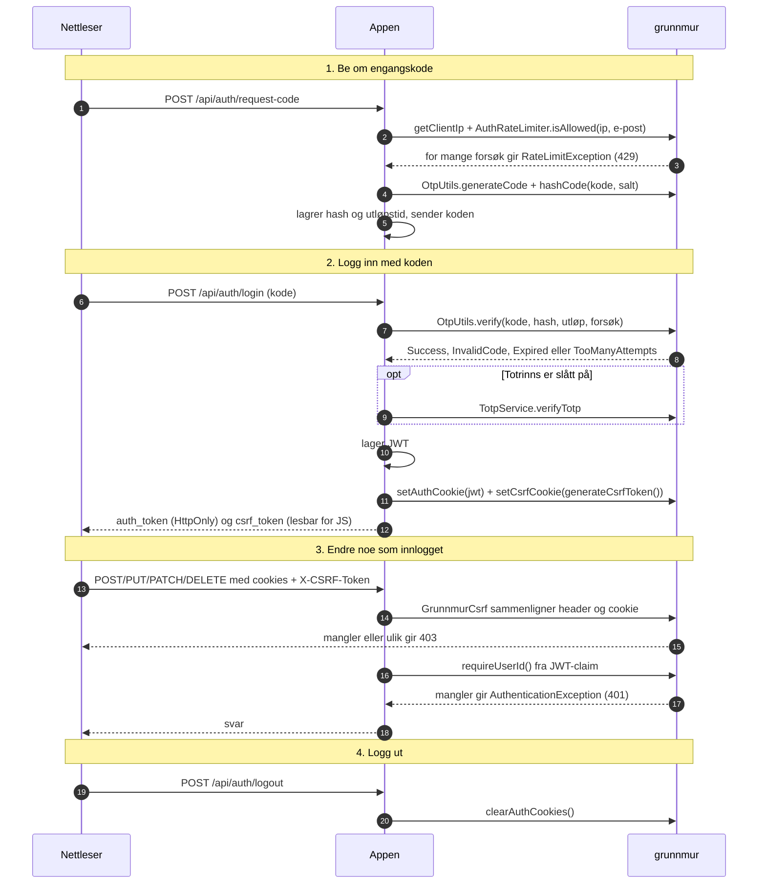

# Innlogging med OTP, JWT-cookie og CSRF

grunnmur har byggesteinene til innloggingen, men ikke hele flyten. Appen lagrer OTP-hashen, sender koden, lager JWT-en og konfigurerer Ktor sin `authenticate`. grunnmur sørger for at koden lages og sjekkes likt i alle appene, at cookiene får samme flagg, og at muterende kall uten riktig CSRF-token stoppes.

Detaljer som ikke får plass i figuren:

- `GrunnmurCsrf` sjekker bare POST, PUT, PATCH og DELETE, hopper over stier i `exemptPaths`, og slipper gjennom kall uten auth-cookie. Innloggingsrutene må derfor stå i `exemptPaths`, og beskyttelsen gjelder fra cookien er satt.
- Sammenligningen av token skjer i konstant tid (`MessageDigest.isEqual`).
- Begge cookiene har `SameSite=Strict` i produksjon og `Lax` med `devMode = true`, og levetid 30 dager som standard.
- `OtpUtils.verify` sjekker i denne rekkefølgen: forsøksgrense, utløp, dev-kode og til slutt hash. Dev-koden virker bare med `devMode = true`.
- `authRateLimiterWithIdentifier()` teller både per IP (5 per minutt og 10 per time) og per identifikator (5 per 15 minutter). Identifikatoren hashes med et salt som lages ved oppstart.
- Unntakene blir til HTTP-svar i `grunnmurExceptionHandlers`, som appen installerer i `StatusPages`.
